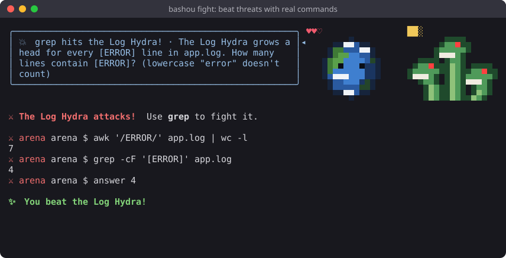
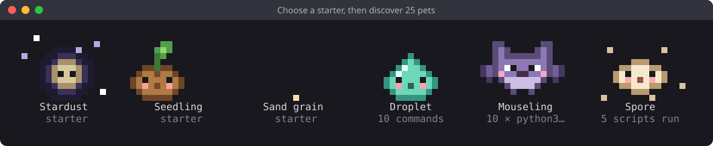
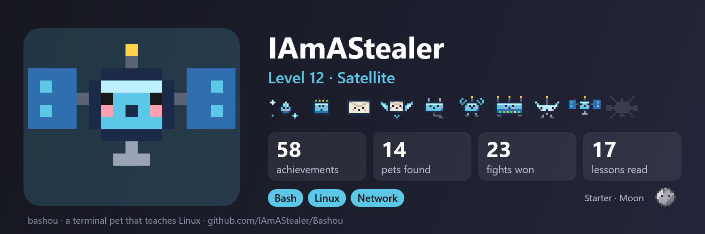

# Bashou

[English](README.md) · **Français**

[](https://github.com/IAmAStealer/Bashou/actions/workflows/ci.yml)
[](https://github.com/IAmAStealer/Bashou/actions/workflows/codeql.yml)
[](https://scorecard.dev/viewer/?uri=github.com/IAmAStealer/Bashou)
[](https://github.com/IAmAStealer/Bashou/releases/latest)
[](LICENSE)

**Un compagnon en pixel art dans le coin de ton terminal, qui grandit pendant que tu apprends la ligne de commande.**
Gratuit, hors ligne, sans compte, sans IA. Le jeu est traduit en français : `bashou config language fr`.

| Un compagnon qui donne des astuces, et `bashou learn` | Des combats dans un shell bac à sable |
|---|---|
|  |  |
| **Des compagnons à trouver** | **Une bannière à partager** |
|  |  |

## Installer

Bashou a ses propres dépôts signés : installe-le une fois, et il se met à jour avec le reste de ton système.

**Debian, Ubuntu** (apt) :

```bash
sudo mkdir -p -m 755 /etc/apt/keyrings
sudo curl -fsSLo /etc/apt/keyrings/bashou.asc https://iamastealer.github.io/Bashou/bashou.asc
printf '%s\n' 'Types: deb' 'URIs: https://iamastealer.github.io/Bashou/deb/' 'Suites: ./' \
  'Signed-By: /etc/apt/keyrings/bashou.asc' | sudo tee /etc/apt/sources.list.d/bashou.sources
sudo apt update && sudo apt install bashou
```

**Rocky, Alma, RHEL, Fedora** (dnf) :

```bash
sudo curl -fsSLo /etc/yum.repos.d/bashou.repo https://iamastealer.github.io/Bashou/bashou.repo
sudo dnf install bashou
```

Ouvre un nouveau terminal : ton compagnon est là. Chaque utilisateur a le sien, sauf root.
`bashou off` le cache, aussi dans les nouveaux terminaux. `bashou on` le fait revenir.
Pas de compagnon sur Debian ou Ubuntu ? Lance `bashou on` une fois : ça ajoute une ligne à ton `~/.bashrc` (à ton `~/.zshrc` si tu le tapes dans zsh).
Les mises à jour arrivent avec `apt upgrade` ou `dnf upgrade`.

**macOS**, **tout autre Linux**, zsh seul, ou git pour suivre le code au fur et à mesure : voir [INSTALL.fr.md](INSTALL.fr.md).

## Ce que tu peux faire

Commence par bash. Ensuite, choisis : Linux, les paquets, gpg et pass, SQL, la CI/CD, Python, C ou Rust.
Bashou vit dans ton vrai terminal, pendant que tu travailles : un seul compagnon pour tous tes terminaux, et il ne dessine jamais par-dessus ton texte.

| Commande | Ce qu'elle fait |
|---|---|
| `bashou learn <commande>` | Démonte une commande et explique chaque morceau : options, arguments, pipes, redirections (88 commandes, de `ls` à `tar`, `awk`, `gpg` et `kubectl`) |
| *(ton compagnon)* | Donne des astuces en chemin (Ctrl+R, `cd -`, `du -sh *`…) et repère les outils que tu n'as pas encore essayés |
| *(succès)* | **304 succès** récompensent de vraies compétences : un pipe de 3 commandes, `find -exec`, `sed -i`, `git bisect`… |
| `bashou fight` | Des menaces apparaissent de temps en temps : bats-les dans un shell bac à sable avec le bon outil, `grep` contre l'Hydre des logs, `awk` contre le Golem comptable |
| `bashou lesson` | La bibliothèque de la Chouette sage : des leçons avec des dessins qui se complètent page après page, sur un parcours qui s'ouvre quand tu réussis |
| `bashou project` | 13 vrais projets en Python, Shell, C et Rust (fusionner des PDF, trier des photos, un script de sauvegarde…), un petit pas à la fois |
| `bashou spot` | Jeu rapide : une IPv6, un hash, du base64, un JWT… dis ce que c'est, de plus en plus vite |
| `bashou arena` | Un combat chronométré, ou une enquête de sécurité (un fichier caché, une porte dérobée dans cron, un binaire SUID) |
| `bashou adventure` | Une balade à travers 13 thèmes avec 486 questions sur ce qui tourne mal et ce qu'il faut vérifier en premier, des boss et des coffres |
| `bashou share` | Un QR code : ton téléphone dessine une bannière de ton compagnon et de ta progression, à envoyer où tu veux |

<details>
<summary><b>Plus sur les combats</b></summary>

Ça commence par les premiers pas (une option à trouver dans `--help`, une faute à corriger dans ton
éditeur, des fichiers à ranger) et ça monte jusqu'aux droits Linux, aux services et aux conflits de fusion
git. Une commande réussie avec le bon outil touche l'ennemi ; les autres te coûtent un cœur.

- **Combats de code** : un petit fichier Python, C ou Rust cassé à réparer (un `;` oublié, une boucle sans
  fin, une fuite de mémoire, une injection shell).
- **Combats de scripts** : un script bash avec une habitude qui va au prompt et devient un bug dans un script
  (la sortie de `ls` dans une boucle, un nom qui commence par `-`, `local x=$(cmd)`, `echo` sur des données,
  un fichier temporaire oublié) : ta correction ne gagne que si le script remarche sur les fichiers piégés de Bashou.
- **Combats de paquets** : interroge ta propre machine avec `apt`, `dpkg` ou `rpm`, ou répare un fichier de dépôt.
- **Combats CI/CD** : un fichier GitHub Actions ou GitLab CI à réparer.
- **Combats SQL** : une base SQLite à interroger et à réparer.
- **Combats de secrets** : `gpg` et `pass`, avec leur propre clé et leur propre coffre d'entraînement : les tiens ne sont jamais touchés.
- **Combats réseau** : tes adresses et tes routes avec `ip`, un service avec `ss`, des captures avec
  `tcpdump -r` ; rien ne sort de ta machine.

Les combats gagnés reviennent après 1, 7 et 30 jours (répétition espacée), pour que ce que tu as appris reste.
Dans un combat, `lesson` ouvre la leçon qui l'explique.

</details>

## Les compagnons

Choisis un compagnon de départ : Poussière, Graine ou Caillou. Il grandit jusqu'au niveau 20 et change de
forme en chemin. 32 autres compagnons se cachent dans ton terminal, chacun selon ce qu'il représente : une
Gouttelette après tes 10 premières commandes, un codeur de nuit pour tes premiers programmes, un champignon
pour tes propres scripts… Le tableau des compagnons ne montre que leur silhouette tant que tu ne les as pas
rencontrés.

**`bashou share`** liste exactement ce que contient la bannière avant le QR code : pas de commandes, de
fichiers, de noms de machines ni de dates. La progression voyage dans le lien, après le `#`, une partie que
les navigateurs n'envoient jamais à un serveur. La première fois, il te demande un pseudo.

## Quoi de neuf

**0.11.0**
- **Ton chemin dans la bibliothèque** : les leçons à suivre ensuite d'abord (`f` les montre toutes), et
  les leçons difficiles attendent que tu maîtrises celles d'avant.
- systemd fait partie de Linux, et la famille Escargot est redessinée en limace qui construit sa coquille.

**0.10.6**
- **Certificats** : six leçons et dix combats, de la lecture d'un certificat jusqu'à ta propre CA et la
  révocation, et un nouveau compagnon, le Phoque, qui grandit avec eux.
- Les leçons et questions SQL corrigées et vérifiées requête par requête.

**0.10.5**
- **Les scripts bash** deviennent une compétence à part, avec huit combats qui lancent ton script corrigé
  sur des fichiers piégés.

**0.10.4**
- Tu as fui un combat ? Ton compagnon arrête de te le rappeler ; la menace t'attend quand même avec
  `bashou fight` jusqu'à minuit.
- Gary a ses vraies couleurs : des yeux jaune-vert aux pupilles rouges et un ventre vert.

**0.10.3**
- **Les menaces attendent toute la journée** : un combat attend jusqu'à minuit et ton compagnon répète son
  avertissement toutes les demi-heures, pour que tu ne le rates pas. Les joueurs expérimentés ont jusqu'à
  2 menaces par jour.
- Avec Homebrew, Bashou tourne sur le Python 3.15 de Homebrew.

Tous les changements, version par version (en anglais) : [CHANGELOG.md](CHANGELOG.md).

## Joue sur deux ordinateurs

**`bashou export`** écrit ta progression dans un petit fichier texte, `bashou-save-DATE.txt`, dans le
dossier où tu es. Emporte-le sur l'autre ordinateur comme tu veux (un mail à toi-même, une pièce jointe,
une messagerie), puis lance **`bashou import bashou-save-DATE.txt`** là-bas, ou `bashou import` seul et
colle le texte. Rien n'est perdu : pour chaque chose, Bashou garde le meilleur des deux ordinateurs.

Par défaut le fichier ne contient que tes succès, tes compagnons, tes leçons, tes combats et ton
aventure : aucune commande, aucun compteur d'outils, aucune date. `bashou export --full` emporte tout,
compteurs compris. Les deux ordinateurs doivent avoir la même version de Bashou.

## Tes données restent sur ta machine

Bashou ne collecte rien. Pas de compte, pas de télémétrie, pas de statistiques, pas de pub : **tu n'es pas le
produit.** Il lit tes commandes seulement pour compter les outils et les constructions, garde ces compteurs dans
`~/.local/share/bashou`, et ne les envoie jamais nulle part. La seule chose qu'il demande à internet, c'est si
une nouvelle version est sortie (une fois par jour ; `bashou config updates off` l'arrête, et avec apt ou dnf
c'est ton gestionnaire de paquets qui s'en occupe).

Bashou est un petit projet perso, fait avec des jetons d'IA en trop par quelqu'un qui aime enseigner et aider
les gens. Il n'y a rien à vendre.

## Utiliser

```bash
bashou                       # voir comment va ton compagnon
bashou -h                    # toutes les commandes
bashou here                  # amener ton compagnon dans ce terminal
bashou config language fr    # le jeu en français
bashou update                # prendre la nouvelle version (apt ou dnf pour les paquets)
```

## Désinstaller

Installé en paquet : `sudo apt remove bashou` ou `sudo dnf remove bashou`, puis enlève la ligne
`source /usr/share/bashou/bashou.bash` de `~/.bashrc` si tu l'avais ajoutée (et la ligne `bashou.zsh` de `~/.zshrc`).

Installé avec git ou Homebrew : voir [INSTALL.fr.md](INSTALL.fr.md#désinstaller).

Ta progression reste dans `~/.local/share/bashou` (supprime-le aussi pour tout oublier).

## Plus

Le [guide](doc/GUIDE.md) (en anglais) explique les compagnons, les succès, les combats et les traductions.
Un bug, une idée ? [Signale un bug](https://github.com/IAmAStealer/Bashou/issues/new?template=6-bug-fr.yml)
ou [propose une idée](https://github.com/IAmAStealer/Bashou/issues/new?template=7-idea-fr.yml).
Envie d'aider ? Pixel art, leçons, défis de sécurité et questions d'aventure sont les bienvenus :
[contribuer](.github/CONTRIBUTING.fr.md).

Licence MIT.
