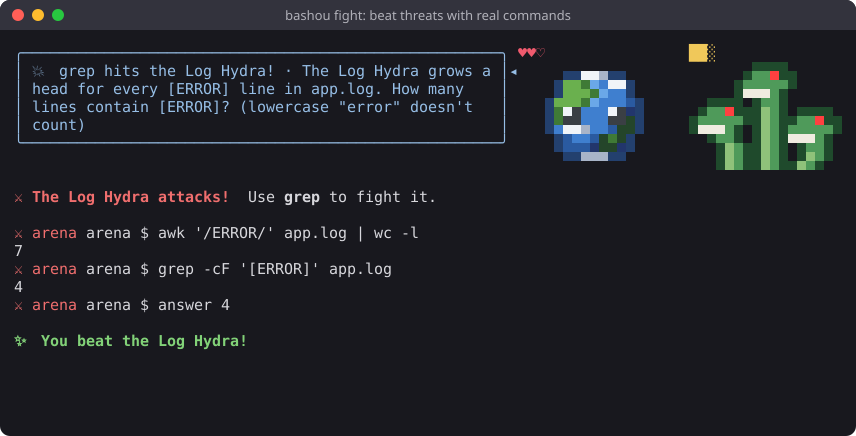
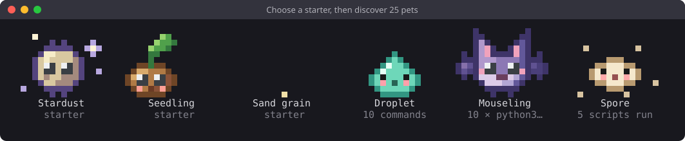
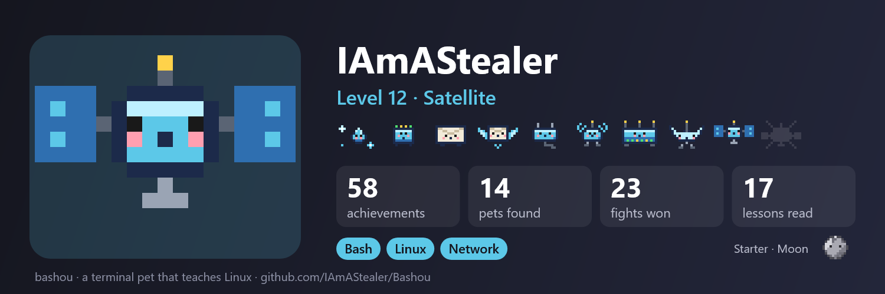

# Bashou

[English](README.md) · **Français**

[](https://github.com/IAmAStealer/Bashou/actions/workflows/ci.yml)
[](https://github.com/IAmAStealer/Bashou/actions/workflows/codeql.yml)
[](https://scorecard.dev/viewer/?uri=github.com/IAmAStealer/Bashou)
[](https://github.com/IAmAStealer/Bashou/releases/latest)
[](LICENSE)

**Un compagnon en pixel art dans le coin de ton terminal, qui grandit pendant que tu apprends la ligne de commande.**
Gratuit, hors ligne, sans compte, sans IA. Le jeu est traduit en français : `bashou config language fr`.

| Un compagnon qui donne des astuces, et `bashou learn` | Des combats dans un shell bac à sable |
|---|---|
|  |  |
| **Des compagnons à trouver** | **Une bannière à partager** |
|  |  |

## Installer

Bashou a ses propres dépôts signés : installe-le une fois, et il se met à jour avec le reste de ton système.

**Debian, Ubuntu** (apt) :

```bash
sudo mkdir -p -m 755 /etc/apt/keyrings
sudo curl -fsSLo /etc/apt/keyrings/bashou.asc https://iamastealer.github.io/Bashou/bashou.asc
printf '%s\n' 'Types: deb' 'URIs: https://iamastealer.github.io/Bashou/deb/' 'Suites: ./' \
  'Signed-By: /etc/apt/keyrings/bashou.asc' | sudo tee /etc/apt/sources.list.d/bashou.sources
sudo apt update && sudo apt install bashou
```

**Rocky, Alma, RHEL, Fedora** (dnf) :

```bash
sudo curl -fsSLo /etc/yum.repos.d/bashou.repo https://iamastealer.github.io/Bashou/bashou.repo
sudo dnf install bashou
```

Ouvre un nouveau terminal : ton compagnon est là.

**macOS**, **tout autre Linux**, zsh seul, ou git pour suivre le code au fur et à mesure : voir [INSTALL.fr.md](INSTALL.fr.md).

## Ce que tu peux faire

Apprends bash pendant que tu travailles, dans ton vrai terminal : astuces de ton compagnon, combats, leçons, projets et quiz.
Ensuite, choisis : Linux, les paquets, gpg et pass, SQL, la CI/CD, Python, C ou Rust.

## Les compagnons

Choisis un compagnon de départ : Poussière, Graine ou Caillou. Il grandit jusqu'au niveau 20 et change de forme en chemin.
32 autres compagnons se cachent dans ton terminal, chacun gagné par ce qu'il représente.

## Tes données restent sur ta machine

Bashou ne collecte rien : pas de compte, pas de télémétrie, pas de pub. [Détails](doc/COMMANDS.fr.md#tes-données-restent-sur-ta-machine).

## Utiliser

```bash
bashou                       # voir comment va ton compagnon
bashou -h                    # toutes les commandes
bashou here                  # amener ton compagnon dans ce terminal
bashou config language fr    # le jeu en français
bashou update                # prendre la nouvelle version (apt ou dnf pour les paquets)
```

## Plus

| À lire | Pour |
|---|---|
| [Commandes](doc/COMMANDS.fr.md) | Ce que fait chaque commande, les combats, deux ordinateurs, tes données |
| [Autres installations](INSTALL.fr.md) | macOS, tout autre Linux, git, Homebrew, désinstaller |
| [Guide](doc/GUIDE.md) (en anglais) | Compagnons, succès, combats, traductions |
| [Changelog](CHANGELOG.md) (en anglais) | Tous les changements, version par version |
| [Comment ça a commencé](doc/STORY.md) | Fait avec l'IA pour un usage responsable ; la version Rust est écrite à la main |
| [Contribuer](.github/CONTRIBUTING.fr.md) | Pixel art, leçons, défis de sécurité, questions d'aventure |

[Signaler un bug](https://github.com/IAmAStealer/Bashou/issues/new?template=6-bug-fr.yml) ou [proposer une idée](https://github.com/IAmAStealer/Bashou/issues/new?template=7-idea-fr.yml).

Licence MIT.
