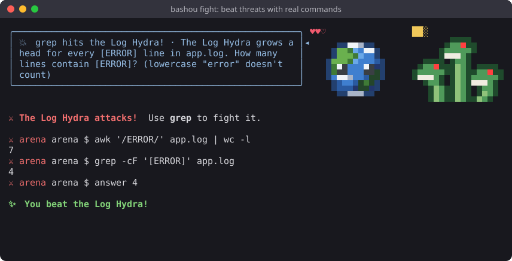
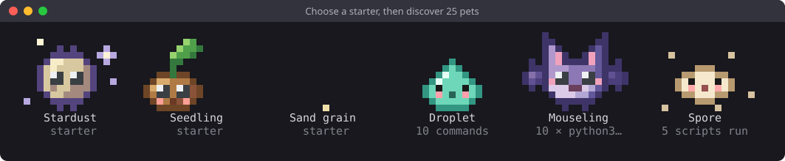
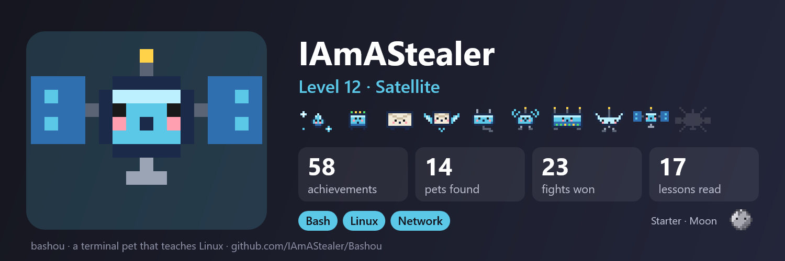

# Bashou

**English** · [Français](README.fr.md)

[](https://github.com/IAmAStealer/Bashou/actions/workflows/ci.yml)
[](https://github.com/IAmAStealer/Bashou/actions/workflows/codeql.yml)
[](https://scorecard.dev/viewer/?uri=github.com/IAmAStealer/Bashou)
[](https://github.com/IAmAStealer/Bashou/releases/latest)
[](LICENSE)

**A pixel-art pet in the corner of your terminal that grows while you learn the command line.**
Free, offline, no account, no AI.

| A pet that gives tips, and `bashou learn` | Fights in a sandbox shell |
|---|---|
|  |  |
| **Pets to find** | **A banner to share** |
|  |  |

## Install

Bashou has its own signed repositories: install it once, and it updates with the rest of your system.

**Debian, Ubuntu** (apt):

```bash
sudo mkdir -p -m 755 /etc/apt/keyrings
sudo curl -fsSLo /etc/apt/keyrings/bashou.asc https://iamastealer.github.io/Bashou/bashou.asc
printf '%s\n' 'Types: deb' 'URIs: https://iamastealer.github.io/Bashou/deb/' 'Suites: ./' \
  'Signed-By: /etc/apt/keyrings/bashou.asc' | sudo tee /etc/apt/sources.list.d/bashou.sources
sudo apt update && sudo apt install bashou
```

**Rocky, Alma, RHEL, Fedora** (dnf):

```bash
sudo curl -fsSLo /etc/yum.repos.d/bashou.repo https://iamastealer.github.io/Bashou/bashou.repo
sudo dnf install bashou
```

Open a new terminal: your pet is there.

**macOS**, **any other Linux**, zsh only, or git to follow the code as it's written: see [INSTALL.md](INSTALL.md).

## What you can do

Learn bash while you work, in your real terminal: tips from your pet, fights, lessons, projects and quizzes.
Then pick what you want: Linux, packages, gpg and pass, SQL, CI/CD, Python, C or Rust.

## Pets

Choose a starter: Stardust, Seedling or Pebble. It grows up to level 20 and changes shape along the way.
32 more pets hide in your terminal, each earned by what it stands for.

## Your data stays on your machine

Bashou collects nothing: no account, no telemetry, no ads. [Details](doc/COMMANDS.md#your-data-stays-on-your-machine).

## Use

```bash
bashou          # see how your pet is doing
bashou -h       # all commands
bashou here     # bring your pet to this terminal
bashou update   # get the new version (your pet tells you when there is one; apt or dnf for packages)
```

## More

| Read | For |
|---|---|
| [Commands](doc/COMMANDS.md) | What each command does, fights, two computers, your data |
| [Other installs](INSTALL.md) | macOS, any other Linux, git, Homebrew, uninstall |
| [Guide](doc/GUIDE.md) | Pets, achievements, fights, translations |
| [Changelog](CHANGELOG.md) | Every change, release by release |
| [How it started](doc/STORY.md) | Made with AI for responsible use; the Rust version is written by hand |
| [Contributing](.github/CONTRIBUTING.md) | Pixel art, lessons, security challenges, adventure questions |

[Report a bug](https://github.com/IAmAStealer/Bashou/issues/new?template=1-bug.yml) or [suggest an idea](https://github.com/IAmAStealer/Bashou/issues/new?template=2-idea.yml).

MIT license.
